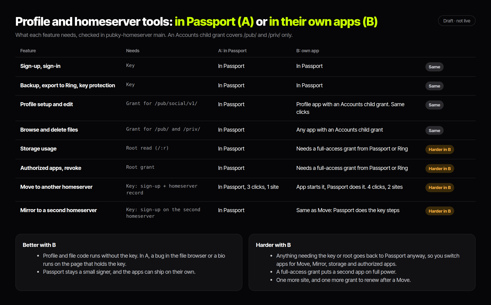
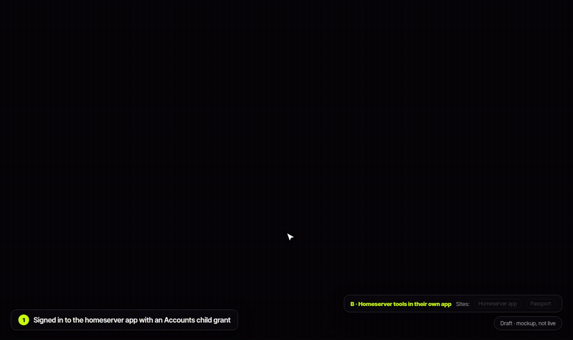

# Profile and homeserver tools: in Passport (A) or in their own apps (B)

Draft. Every GIF is a mockup, not a live flow. Every flow runs in one pop-up that redirects between sites, with the fewest clicks each option allows.

- **Sign-up, log-in and profile edits** take the same number of clicks in A and B. B passes through one more site.
- **Anything that needs the key or a root grant** (Move, Mirror, storage usage, authorized apps) has to go back to Passport in B. That is where B gets harder.
- **What B does better:** profile and file code runs without the key, and Passport stays a small signer.
- **App code is the same** for A and B.



## What the app writes

`createPassportAuth` and `signIn()` are the `@pubky/passport-auth` package (PR #294, in review). `profile`, `accounts` and `editProfile()` are proposed; the Passport v2 client already has the `profile` option.

```ts
const passport = createPassportAuth({
  pubky: new Pubky(),
  capabilities: "/pub/example.com/:rw",
  clientId: "example.com",
  appName: "Example",
  callbackUrl: "/passport/return",
  profile: "required", // proposed
  // accounts: true,   // proposed, suite apps only
});

loginButton.onclick = async () => {
  const result = await passport.signIn();
  if (result.ok) showApp(result.session);
};

editButton.onclick = () => passport.editProfile(); // proposed
```

The SDK opens one pop-up and waits for the session on the relay. Sign-up and log-in are the same call: Passport decides which screens to show. A and B only differ in where Passport or Accounts sends the pop-up next, so that stays out of the SDK and out of the app.

## External apps: sign up

Log in goes straight to Passport. A: 7 clicks, 2 sites. B: 7 clicks, 3 sites.

`signIn()` opens Passport with `profile=required`. Passport runs the profile step itself (A), or sends the pop-up to the profile app and back (B).

**A: profile in Passport**


**B: profile in its own app**


## External apps: log in with a pubky that has no profile yet

A: 5 clicks, 2 sites. B: 5 clicks, 3 sites.

The same `signIn()`. Passport reads `/pub/social/v1/profile.json` first. If a profile exists, it goes straight to the review.

**A**


**B**


## Suite apps: sign up

Log in goes through Accounts, then Passport. A: 7 clicks, 3 sites. B: 7 clicks, 4 sites.

`signIn()` with `accounts: true`. The SDK opens Accounts instead of Passport, and the child grant comes back through the callback page (`handlePassportReturn()`, in #294). In B, Accounts sends the pop-up on to the profile app with a child grant.

**A**


**B**


## Suite apps: log in with a pubky that has no profile yet

A: 5 clicks, 3 sites. B: 5 clicks, 4 sites. If Accounts is already signed in and a profile exists, the pop-up closes with no click.

**A**


**B**


## Signed in, edit your profile

The same for external and suite apps: 2 clicks either way. `editProfile()` opens Passport's profile page (A) or the profile app (B), and resolves when you save.

**A:** Passport holds the key.


**B:** the profile app kept its grant from setup. In a browser where it has none, Accounts gives it one without a click if you're signed in there.


With the key in Ring, both options need a grant: Passport gets one from Accounts (RFC 0002 feature 2), and the profile app gets one the same way.

## Move to another homeserver

Moving needs the key: you sign up on the new homeserver, and your homeserver record (pkarr) has to point there. Both need the key in the Pubky SDK. Passport also has to copy the files, which needs a session on both homeservers. An Accounts child grant covers `/pub/` and `/priv/` only, so it can't do any of this.

**A: in Passport.** 3 clicks, 1 site.


**B: a homeserver app starts it, and Passport does the key steps and the copy.** 4 clicks, 2 sites. The app also can't show storage usage or authorized apps without a full-access grant.



Mirroring to a second homeserver works the same way, because signing up there needs the key too. With the key in Ring, both options need a Ring approval for these steps.

## What B needs to match A

- **Suite apps:** the profile app gets a child grant from Accounts, so there is no extra approval.
- **External apps:** Accounts isn't in the flow, so Passport has to hand the profile app its grant without a review screen, trusting it the way it trusts Accounts. With a review screen, B costs one more click.
- **Storage usage and authorized apps:** need read access on the root (`/:r`) or a root grant. The homeserver app would need a full-access grant from Passport or Ring, which puts a second app on full power.
- **After a Move:** the separate apps' grants have to be renewed on the new homeserver. I haven't checked how Accounts' parent grant carries over.

## Checked and not checked

- **Checked in pubky-homeserver main (`d95161a`):** publishing the homeserver record needs a keypair; `signup` needs the key; grant management needs a root capability; `GET /account` (usage) needs `/:r`; parent grants are capped at `/pub/` and `/priv/`.
- **Checked in PR #294:** `createPassportAuth`, `signIn()`, `callbackUrl` and `handlePassportReturn()` exist.
- **Not checked:** click counts come from the mockups, not built flows. How Homegate ties paid storage to a pubky, and how grants carry over after a Move, are not checked.
