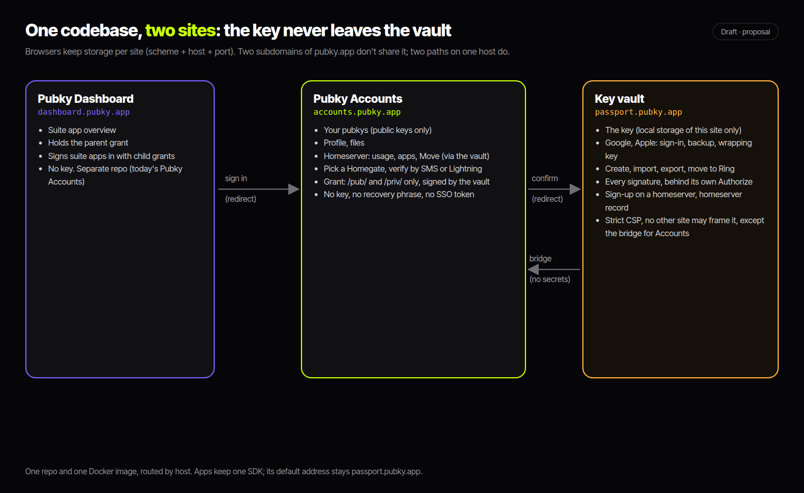

# Design: Pubky Accounts with a separate key vault

Draft for review. Nothing here is built.

Goal: rename the products to **Pubky Dashboard** (`dashboard.pubky.app`, today's Pubky Accounts: parent grant, suite apps) and **Pubky Accounts** (`accounts.pubky.app`, today's Passport codebase). The key sits in a separate key store, and nothing outside that store, including profile, files, homeserver tools and most screens, can read it.



## Can the key store share a domain with Accounts?

**Same domain, yes. Same host, no.**

- Browsers keep `localStorage` and IndexedDB per origin (scheme + host + port).
- `accounts.pubky.app/vault` and `accounts.pubky.app/profile` share one store, so splitting by path gives no isolation.
- Two subdomains (`passport.pubky.app` and `accounts.pubky.app`) get separate stores, even though both sit under `pubky.app`. They are the same *site*, which only matters for cookies. The vault sets no cookies.
- So the vault needs its own subdomain. It can still be the same repo, the same Next.js app and the same Docker image, routed by host.

## Recommendation: keep the vault at `passport.pubky.app`

The vault needs its own subdomain anyway, and `passport.pubky.app` already holds every key and every backup:

- **No key migration.** Local keys today sit in `localStorage` on `passport.pubky.app` (`pubky-passport/local-identities/v1/…`). Another host can't read them, so a new vault host would need a one-time hand-over page for each browser.
- **No backup migration.** Backups are tied to the Passport address: it is mixed into the encryption (`createEnvelopeAdditionalData`, `PassportFileWebCrypto.ts:340`), and the iCloud store rejects `envelope.url !== passportOrigin` (`ICloudPassportFileStore.ts:97`). A new vault host would need to accept the old address and re-encrypt.
- **No SDK change.** `@pubky/passport-auth` already opens `https://passport.pubky.app` by default.
- **No Google/Apple console change.** The OAuth client, Services ID and CloudKit token keep their current address.
- It matches what Aldert and Marcos asked for: Passport is "just the signer".

If you'd rather show `vault.accounts.pubky.app`, the extra work is listed under "If the vault moves" below.

## What runs where

**Key vault** (`passport.pubky.app`): the only code that touches a key, a recovery phrase, a wrapping key or a Google/Apple token.

- Key storage: today's `LocalStorageIdentityRepository`, on this host only.
- Sign-in screen: Mobile Signer QR code, Continue with Google or Apple, Import (recovery phrase or file), choose a pubky.
- Google and Apple: the sign-in pop-up, the backup in Drive or iCloud, the wrapping key route (`/api/wrapping-key/google|apple`, served on this host only). Only this host is registered with Google and Apple, so no other host can get an ID token. That matters: an ID token plus the backup equals the key.
- Create a pubky: the key choice (this browser or Ring), key creation, sign-up on the homeserver with the sign-up code, the backup.
- Every signature behind its own **Authorize** on a vault page:
  - app grants
  - the Dashboard parent grant
  - homeserver moves and mirrors (sign-up on the new homeserver, the homeserver record)
  - export, move to Ring, attach Google or Apple, remove an identity
- The bridge: a hidden page that Accounts frames to ask for public data (see "Bridge API").

**Pubky Accounts** (`accounts.pubky.app`): everything else.

- Your pubkys, from the bridge: public keys, labels and backup status only.
- Profile, files, homeserver usage, authorized apps.
- Onboarding steps that need no key: pick a Homegate, verify by SMS or Lightning, the profile step.
- Its own homeserver session: a grant for client id `accounts.pubky.app` with `/pub/:rw,/priv/:rw`. This is the same cap an Accounts child grant has. The vault signs it (see "Signing policy").

**Pubky Dashboard** (`dashboard.pubky.app`): today's Pubky Accounts repo, renamed. It redirects to the vault for sign-in and the parent grant approval, as in RFC 0001 A.1. No change to its code beyond the address.

## Sign-in and sign-up, step by step

The pop-up, or the tab when a pop-up can't open, moves between hosts by redirect. Clicks are the same as the "B" mockups.

- **External app:** pop-up → vault `/authorize` → sign in → vault review → Authorize → back to the app.
- **Suite app:** pop-up → Dashboard → vault `/authorize` → sign in → vault review of the parent grant → Dashboard → app.
- **Sign-up:** vault `/authorize` → Create a pubky → Accounts `/create`, where you pick a Homegate and verify by SMS or Lightning → back to the vault with the sign-up code → key, sign-up, backup → Accounts `/welcome` for the profile step, using its grant → vault review → app.
- **Sign-up with Google or Apple:** today one ID token is sent both to Homegate for the sign-up code and to the server for the wrapping key, so this verification happens on the vault, not on Accounts.

## Signing policy (in the vault, not in Accounts)

What a compromised Accounts page can get decides whether the split is worth it. The vault enforces:

- **Accounts' own session:** auto-signed with no click, only when the request's client id is `accounts.pubky.app`, its caps are a subset of `/pub/:rw,/priv/:rw` and the relay is allowlisted. It is recorded in the #285 session ledger and revoked at sign-out.
- **Anything else needs a click on a vault page:**
  - grants for other apps, the parent grant, root caps
  - homeserver sign-up and the homeserver record
  - export, move to Ring, attach, remove
  - Accounts can only send the browser to `passport.pubky.app/confirm?op=…`. That page renders the request itself, is a full page (`frame-ancestors 'none'`, so nothing can overlay it), and returns to an allowlisted Accounts URL.
- **Never sent to Accounts:** the secret key, the recovery phrase, the wrapping key, Google/Apple ID or access tokens.

What isolation then buys: a bug or bad dependency on Accounts gets at most `/pub/` and `/priv/` for that session. It can't sign up elsewhere, repoint the homeserver, sign grants for other apps or take the key. A leaked grant can be revoked; a leaked key can't. What it doesn't cover: a compromised vault build or deploy, or a bug in the vault's own screens. So the vault has to stay small and must never render content written by other people or apps.

## Bridge API

`passport.pubky.app/bridge` is a hidden frame on Accounts pages. It is framable only by `https://accounts.pubky.app` (`frame-ancestors`), and it talks over a `MessageChannel`. Every message is checked against a schema and the exact origin.

- `identities.list()` returns `{ publicKey, label, source, backup }[]`.
- `session.approveForAccounts(pubkyauthUrl)` signs Accounts' own grant under the policy above. Accounts starts the SDK grant flow and receives the session through the relay as usual.
- `homeserver.usage()` and `grants.list()` are read with the vault's root session. Accounts never needs root.
- `grants.revoke(grantId)` needs no confirm: at worst an attacker signs you out of apps.
- `confirm.start(op, params)` returns the vault URL to send the browser to; `confirm.result(id)` reads the outcome after the redirect back.

Iframe storage: browsers split a framed site's storage by the top site, but `accounts.pubky.app` and `passport.pubky.app` are the same site, so the bridge sees the vault's normal storage. To verify on staging in Chrome, Firefox and Safari.

## Codebase

One repo, one Next.js app, one image, two hosts:

```
src/
  vault/          key code, moved from src/client/logic:
                  local-identity, passport-file, google-identity, apple-identity,
                  identity-import, identity-lifecycle, wrapping-key client,
                  authorization/approve, signup with code
    ui/           vault screens
    bridge/       bridge server + signing policy
  accounts/       profile, files, homeserver tools, identities overview,
                  Homegate SMS/Lightning steps
  shared/         vault-protocol schemas, UI kit, logger, Result
  server/         wrapping-key routes (vault host only)
  app/(vault)/    routes served on the vault host
  app/(accounts)/ routes served on the accounts host
  proxy.ts        host routing + CSP per host
packages/passport-auth   unchanged, default instance passport.pubky.app
```

Guards, so the split holds after refactors:

- ESLint import boundaries: `src/accounts/**` may import `src/shared/**` only, never `src/vault/**`, and the reverse.
- A build check that the accounts route chunks in `.next` contain no vault module, matched by a marker string. CI fails on a hit.
- `proxy.test.ts` cases:
  - each host 404s the other host's routes
  - `/api/wrapping-key/*` answers only on the vault host
  - CSP per host: vault `connect-src` lists only the homeservers, relays, Homegate, Google/Apple and Drive/CloudKit endpoints; `frame-ancestors` is `'none'` except the bridge
- e2e: after sign-in, no `pubky-passport/local-identities` key exists on the accounts origin, and Accounts' session caps are `/pub/:rw,/priv/:rw`.

Running it: env `VAULT_ORIGIN` and `ACCOUNTS_ORIGIN`. Locally that's two ports, for example `localhost:3000` and `localhost:3001`; different ports are different origins, so dev has the same isolation. Self-hosters run one image on two subdomains.

## Order of work

1. Move the key code into `src/vault/` with the lint boundaries in place. No behaviour change.
2. Host routing in `proxy.ts`, with `accounts.pubky.app` serving the management routes; staging first.
3. The bridge and the signing policy; Accounts gets its own `/pub` + `/priv` session.
4. Move the profile, files and homeserver screens to Accounts, and the confirm pages to the vault.
5. Dashboard rename (Marcos's repo): address and copy only.

## If the vault moves to `vault.accounts.pubky.app`

Extra work:

- **Backups:** read envelopes tied to `https://passport.pubky.app` and to the new host, write new ones with the new host, and re-encrypt on first open.
- **Local keys:** a hand-over page on `passport.pubky.app` opens the new vault from a click and posts the keys to its exact origin. The old copy is deleted after the new vault confirms.
- **Google and Apple:** add the new origin to the OAuth client, the Services ID and the CloudKit token. Check on staging that the Drive app data and the iCloud container open from the new origin.
- **SDK:** change the default instance, and keep `passport.pubky.app` redirecting.

## RFC changes (proposed, not pushed)

**RFC 0001 (#291)**

- Terms: Pubky Dashboard (was Pubky Accounts), Pubky Accounts (account management), key vault (`passport.pubky.app`: key, sign-in, approvals).
- Rename through the text and the four figures (`gen2.py` lane labels).
- Options A.1, A.2 and B: the Dashboard sends you to the vault; the vault returns the parent grant.
- App integration: suite apps through the Dashboard, external apps straight to the vault. The iframe line stays; it is about third-party sites.

**RFC 0002 (#295)**

- Title: "Pubky Accounts as the front end for your pubky".
- New section after Goals, "Key vault":
  - what it holds and which screens it renders
  - the signing policy
  - what isolation stops and what it doesn't
  - two hosts, one image
  - the diagram above
- Features 1 to 4: one line each on where the screens run. Feature 3, the profile, moves to Accounts with its grant. Feature 4: the Homegate SMS and Lightning steps run on Accounts; Google/Apple and key creation run on the vault.
- Feature 2, identities with the key elsewhere: Accounts manages them with a Dashboard child grant or a Ring grant, as now.
- Homeserver management: usage and apps come from the vault bridge; Move and Mirror confirm on the vault.
- Charts: add the vault box to the overview and app-integration charts.
- GIFs: management screens show `accounts.pubky.app` in the address bar, sign-in and approvals show `passport.pubky.app`. That means re-rendering all six.
- Terms: add Pubky Dashboard, Pubky Accounts and key vault.

## Checked and not checked

- **Checked in Passport `main` (`c8e81376`):**
  - key storage key and file
  - the backup's tie to the Passport address and the iCloud origin check
  - Google and Apple run in pop-ups with no third-party scripts
  - the wrapping-key route paths
  - the existing CSP test in `proxy.test.ts`
  - one Google ID token is used for both the Homegate sign-up token and the wrapping key (`GoogleIdentityLifecycle.ts:314-355`)
- **Checked in pubky-homeserver main (`d95161a`):** root is needed for grant management and `/account`; parent grants are capped at `/pub` + `/priv`; the homeserver record and sign-up need the key.
- **Not checked:**
  - bridge storage in Safari and Firefox
  - Next.js route chunks staying separate per route group without extra config
